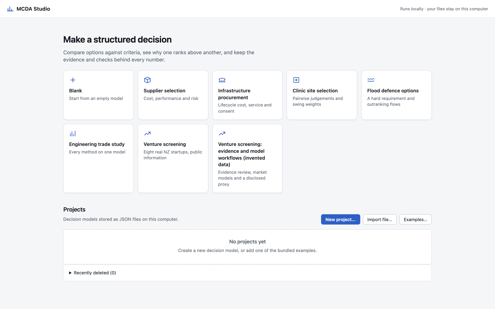
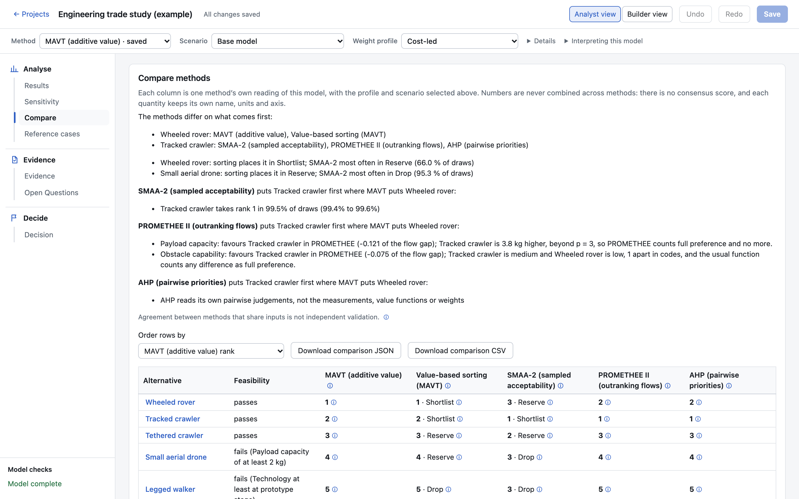
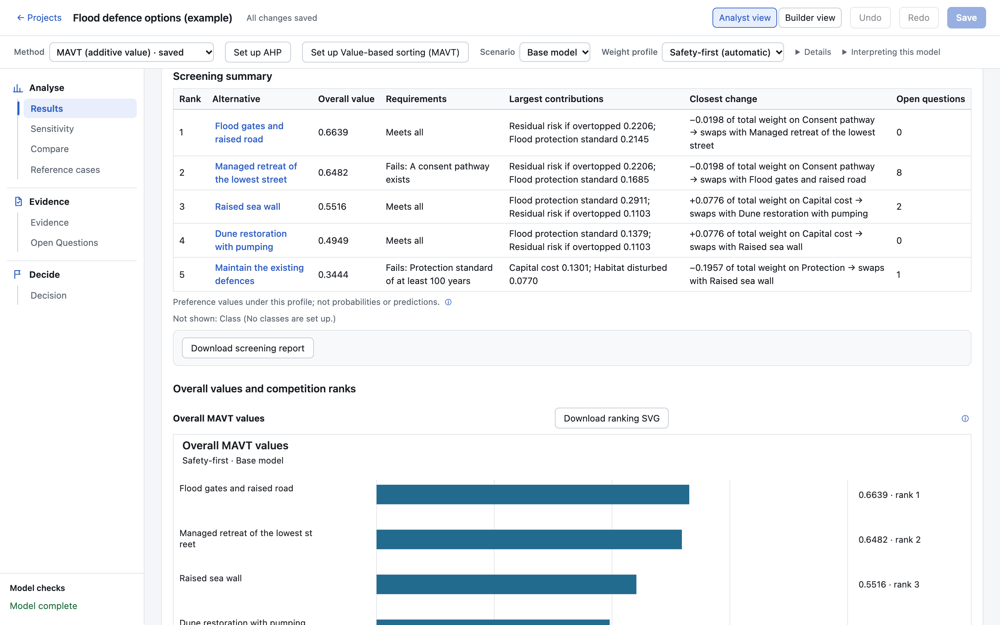
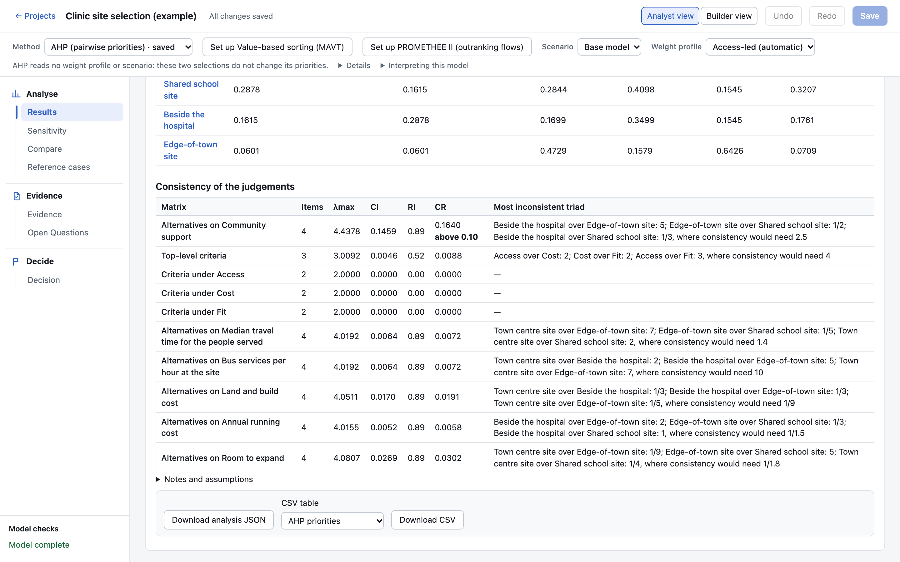
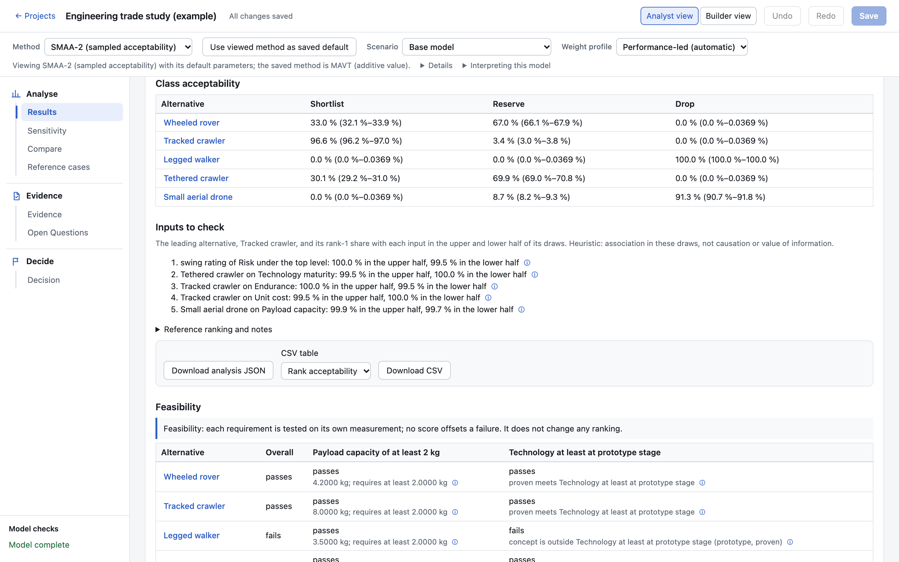
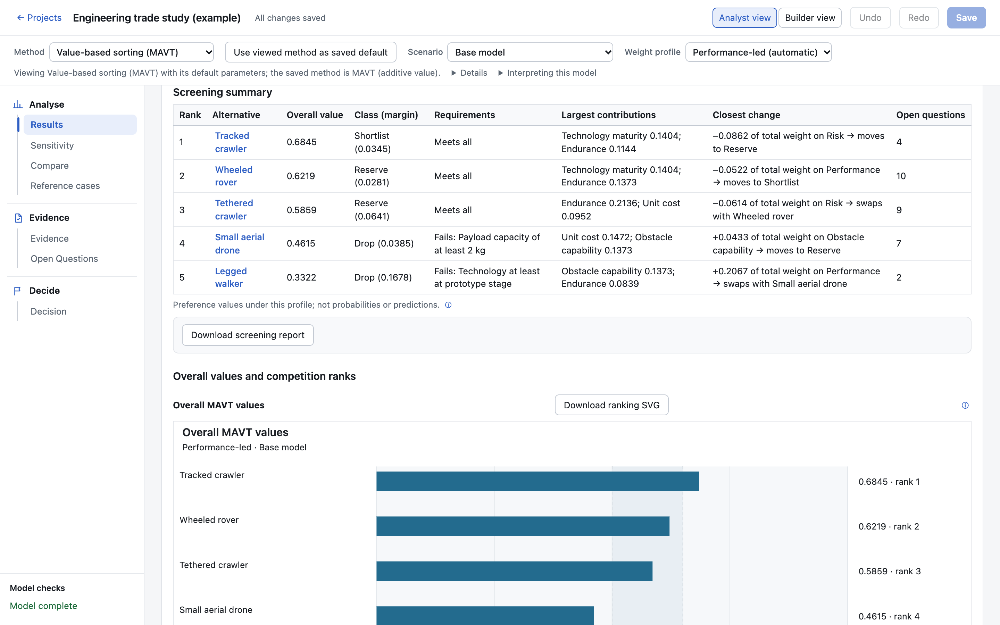
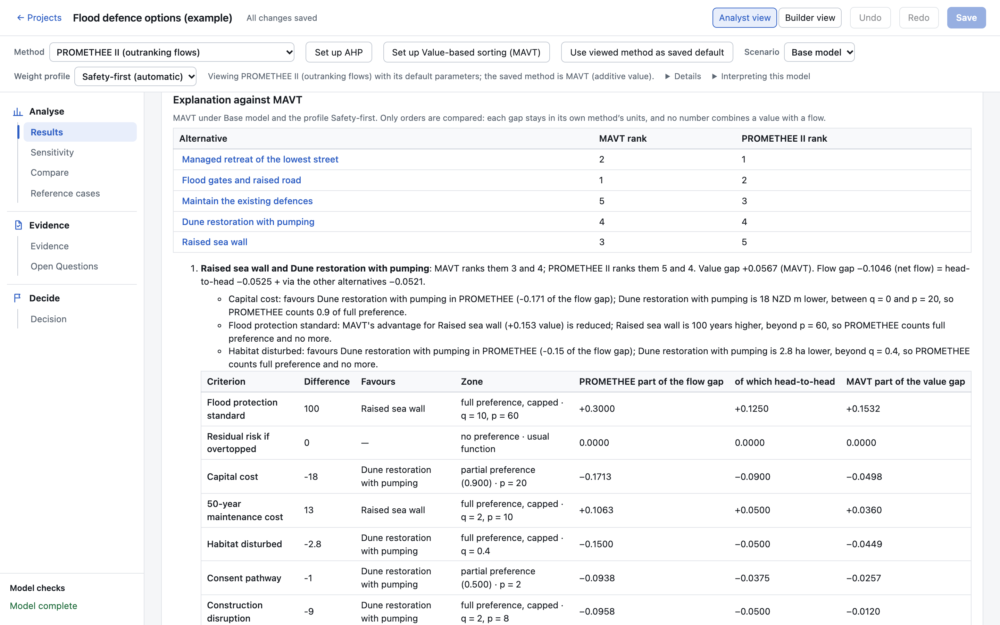
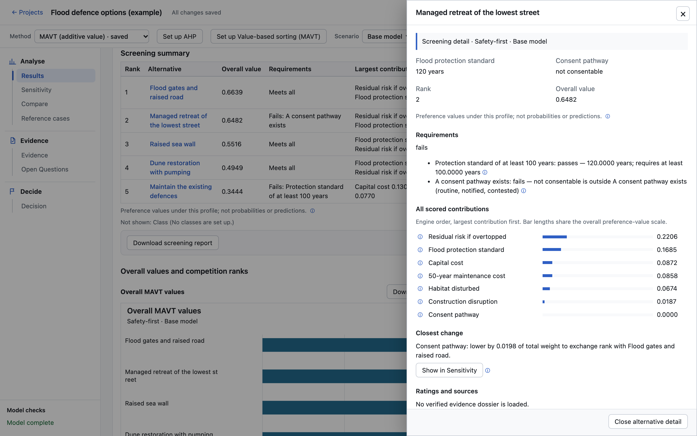

# MCDA Studio

[](https://github.com/spar473/mcda-studio/actions/workflows/ci.yml)
[](LICENSE)


**Transparent multi-criteria decision analysis, on your own computer.** Model a decision once, read it
through five methods, and see where they agree and why they do not. A tested Python engine computes
every number, each method shows only its own assumptions, and nothing is averaged into a consensus.

MCDA Studio screens and prioritises. It does not decide for you, recommend a choice or predict an
outcome. Its engine is domain-neutral: the worked examples below are about clinic sites, flood
defences and inspection vehicles, all invented.

[Methods](#the-methods) · [Worked examples](#worked-examples) · [A quick look](#a-quick-look) ·
[Getting started](#quick-start) · [How to read results](#how-to-read-the-results) ·
[Scope and status](#scope-and-status)



## In one minute

- **What it is:** a local workbench for structured decisions. You state criteria, measurements,
  preferences and mandatory requirements; it ranks, sorts into classes, samples uncertainty, compares
  methods and shows how close each call is.
- **What it is not:** a recommendation engine or a success predictor. No score is a probability. The
  application is offline and never calls a model; model output can enter only as a proposal that a
  person reviews.
- **Status:** a working prototype by one author, checked by an automated test suite, with no
  fresh-user study yet (see [scope and status](#scope-and-status)).
- **Fastest look:** the screens below, then the [six-minute method tour](docs/method-tour.md). To run
  it yourself, follow the [developer setup](#quick-start) (macOS or Linux; on Windows, use WSL2).

## The methods

One model can be read by several methods. Each reads **only its own inputs**, and no method's weights
are ever reused by another.

| Method | The question it answers | It reads | It never |
| --- | --- | --- | --- |
| **Additive MAVT** with swing weighting | How does each option score against the criteria, with the weights I state? | Value functions, swing ratings, a weight profile and a scenario | Treats a score as a probability |
| **Value-based sorting** | Which ordered class does each option fall in? | MAVT values and class boundaries | Reads more than the overall value |
| **SMAA-2** | How stable is the order if I only know ranges and weight intervals? | Stated distributions and rating intervals | Presents a share of draws as a probability of success |
| **PROMETHEE II** | Which option outranks which, pair by pair, with preference thresholds? | Its own directions, weights, thresholds and codes | Reuses swing weights or value functions |
| **AHP** | What priorities follow from pairwise judgements? | Only its own judgements, in groups | Reads measurements or swing weights |
| **Feasibility check** | Does each option meet the mandatory requirements? | Requirements on individual measurements | Lets any score offset a failure |
| **Compare** | Where do the methods agree, and why do they differ? | Each method's own result | Averages, ranks or reconciles them |

The [specification](docs/mathematics/specification.md) and the per-method
[design notes](docs/design/) give the exact rules; [method limitations](docs/mathematics/method-limitations.md)
says when a method may be inappropriate.

## Worked examples

All of these are invented, with plain-description names and no real organisations. Open one from the
start page, or from **Projects → Examples**.

| Example | What it shows |
| --- | --- |
| [`engineering_trade_study`](examples/engineering_trade_study/README.md) | Five inspection-vehicle concepts, **every method on one model**: MAVT with two profiles and a scenario, sorting classes, SMAA-2 uncertainty, PROMETHEE II, 78 AHP judgements and two requirements, so Compare shows five real columns |
| [`flood_defence_options`](examples/flood_defence_options/README.md) | Five flood defence options: a **hard requirement beside every ranking** (a failing option stays ranked), and PROMETHEE II beside MAVT, with its capped preferences and an exact-threshold pair |
| [`clinic_site_selection`](examples/clinic_site_selection/README.md) | Four clinic sites: **AHP pairwise judgements** beside separately stated swing weights, with one matrix deliberately inconsistent so the consistency warning is visible |
| [`supplier_selection`](examples/supplier_selection/README.md) | A compact procurement problem with every scale and value-function kind, checked against an independent oracle |
| [`supplier_qualification`](examples/supplier_qualification/README.md) | The same suppliers **sorted into classes**, with a class change under a scenario and an audit sample |
| [`infrastructure_procurement`](examples/infrastructure_procurement/README.md) | A three-level tree with an only child, a zero rating and two disagreeing profiles |

[`examples/README.md`](examples/README.md) lists every folder, including small demonstrations of the
evidence workflow, proposal review, calculated measurements and formula models. Three folders are
about **real New Zealand companies**, from public information, with their own disclaimers; they are the
subject of a separate application, [venture-frame](https://github.com/spar473/venture-frame), and are
kept here because the engine's tests use them as fixtures.

## A quick look

| | |
| --- | --- |
|  |  |
| **Compare methods.** The trade study under its Cost-led profile: where the five methods lead differently, each gives its own reason. There is no consensus score. | **Requirements.** A hard limit sits beside the ranking; no score offsets it, and a failing option stays ranked. |
|  |  |
| **AHP.** Priorities from pairwise judgements, with each matrix's consistency ratio and its most inconsistent triad. | **SMAA-2.** Shares of draws under stated uncertainty, with exact intervals; a share is not a probability of success. |
|  |  |
| **Sorting.** Ordered classes with fixed boundaries, each option's distance to the nearest one. | **PROMETHEE II.** Net outranking flows and, where it differs from MAVT, which criteria and thresholds are behind it. |
|  | |
| **Alternative detail.** Click any option for its requirements, every scored contribution and its closest change. Read-only. | |

The screens show the invented studies in the Analyst view (the view the gallery's worked examples open
in); Builder view adds the model editors. They were captured at 1440 × 900.

## Features

**Evidence**

- The Evidence Workspace supports local claim inspection, explicit review, acknowledged compilation
  into a separate project copy, history-preserving exports and reproducible compilation bundles for
  the synthetic [venture and supplier demonstrations](examples/evidence_demo/README.md). Imported
  copies are related to their bundles through copy receipts. The Decision tab records, exports,
  reopens and revises version-2 decision records that cite those bundles and trace each
  measurement to them.
- External proposals add generic local JSON/CSV intake, model-card/source disclosure, exact
  tool/human comparisons, explicit individual or filtered bulk review, and history-preserving
  compilation into a separate copy. Confidence stays metadata and annotations stay outside
  numerical aggregation. See the invented [screening and supplier examples](examples/external_proposals/README.md)
  and [published interchange contract](docs/schemas/external-proposals-csv.md).
- A standalone offline [classifier agreement benchmark](examples/classifier_benchmark/README.md):
  human–human agreement gate with exact kappa and a grouped bootstrap interval, then exact
  confusion, abstention, baseline and calibration summaries against the reviewed reference. It is
  outside the application, calls no model and uses only local files.

**Modelling**

- A manifest-driven Blank, Supplier selection, Infrastructure procurement, Clinic site selection, Flood
  defence options, Engineering trade study and Venture screening gallery. Fresh illustrative projects clear reviews and runs; intact worked examples retain
  them. Exported lineage receipts record the exact creation/reset and all local file hashes.
  See the [invented formula models](examples/market_research/README.md).
- Arbitrary-depth objective trees with stable IDs, so renaming never corrupts data.
- Categorical, ordinal, interval and ratio scales.
- Linear, piecewise-linear, qualitative and direct-rating value functions, with fixed or local
  anchors and an explicit out-of-domain policy.
- A graphical and tabular value-function editor. Changes are previewed, applied in one undoable
  step, and never applied by accident.

**Preferences**

- Hierarchical swing weighting over stated worst-to-best ranges. You see raw ratings, local
  weights, branch shares and global weights side by side.
- Multiple independent preference profiles, for example one per decision maker.
- Range-review warnings when a change alters what a weight means. Ratings are never silently
  adjusted.

**Optional screening tools**

- **Decision impact:** an opt-in, read-only check of each qualitative or ordinal rating one cell at
  a time (every other label), so the analyst sees which judgements could change a rank or class.
- **Reference cases:** opt-in, read-only similarity between today's companies and past ones rated
  as of a dated snapshot, from a separate `reference-cases` file; outcomes are shown only on
  request, and a company can be left out of its own comparison. The
  [first-round retrospective](examples/nz_first_round_retrospective/README.md) uses it.

**Model support, kept outside the application**

- A separate [typed-proposal runner](docs/design/typed-proposal-runner.md)
  (`scripts/typed_proposal_runner.py`) classifies cited source text into External Proposals with a
  local model (Qwen, Laya) or a hosted typed classifier. It never imports the application, never
  sees the analyst's ratings or notes, and its output is reviewed like any other proposal.
- A [blind rater kit](docs/design/blind-rater-kit.md), a [name-swap check](docs/design/name-swap-check.md)
  and the classifier agreement benchmark decide whether a human reference exists before any tool
  is compared with it. No tool accuracy is claimed: the second blind rater has not rated yet.

**Analysis**

- Optional disclosed model proxy: explicitly reviewed model card, feature overlap and swing ratings,
  with a separate with/without comparison for MAVT, sorting or fixed-weight factor SMAA-2. The
  original project remains the baseline; imported confidence never becomes a weight.

- A self-contained **screening report**: one HTML file (no script, font or image) with the summary for every profile, the profile comparison, mandate failures, method leaders, evidence freshness and top open questions, from `mcda report screening` or a Results button.
- A read-only screening workspace: an Analyst view that opens on the screening summary (Builder view
  adds the model editors), an alternative detail drawer with every scored contribution and the sourced
  rubric level behind each rating, a separate comparison of any two weight profiles with no
  combined ranking, and a temporary what-if trial of raw swing ratings that re-ranks only the
  summary and ranking chart. A trial is never saved, cannot save a profile, and blocks the other
  views and all downloads until Reset.
- One-way weight sensitivity with exact, closed-form crossovers, stability intervals and an exact
  probe at any weight.
- Scenarios that override individual value functions and/or use another profile, compared with
  Base.
- Linked results: overall values, weighted contributions, partial-value heatmap and a dominance
  matrix.
- Tie-aware competition ranking (1, 1, 3) everywhere.
- Value-based sorting into ordered classes (for example Qualified / Conditional / Not qualified)
  by fixed boundaries on the overall value: each option's class and distance to the nearest
  boundary, the exact weight at which it first changes class, class bands on the charts, and an
  optional seed-keyed audit sample below a cut-off. Choosing a method is a view, like choosing a
  profile; nothing is edited until you make it the saved default.
- SMAA-2: state ranges or discrete outcomes for measurements and uncertainty for weights, then see
  how often each option takes each rank and class, with exact (Clopper–Pearson) intervals, a
  recorded seed and the label "sampled acceptability under these assumptions". Small discrete
  cases are computed exactly.
- PROMETHEE II: state each criterion's direction, weight and preference function (usual, U-shape,
  V-shape or linear, with thresholds in its units) and codes for labelled scales, then see net
  outranking flows on their own −1 to 1 axis, the PROMETHEE I partial order with its incomparable
  pairs, and an explanation of every pair it orders differently from MAVT: which criteria and
  thresholds are behind it, and how much of the gap comes from the other alternatives. Its inputs
  are its own, never the swing weights or value functions.
- AHP: judge criteria in pairs within each group, and the alternatives in pairs on each leaf, on
  Saaty's 1–9 scale; see each matrix's priorities, consistency ratio and most inconsistent triad
  live as you judge, then the overall priorities in distributive or ideal synthesis. Its judgements
  are its own and never become MAVT weights.
- Compare methods: every method's own reading of the same model side by side, each column naming
  what it read, where the methods agree on what comes first, and each method's own reason where
  they differ. A method that cannot read the model says why. There is no consensus score.
- Feasibility check: state mandatory requirements on individual measurements (a numeric bound in
  the criterion's own unit, or a set of allowed labels, with "at least" and "at most" helpers for
  ordinal scales) and see each alternative pass, fail or be unknown, live as you edit. A missing
  measurement is unknown, never a failure. No method reads requirements and no score offsets a
  failure: every ranking stays complete, with feasibility beside it in Results and the comparison.
- Retry after a failed analysis request. Retrying re-sends the same request and never edits the
  project.
- Open Questions: missing inputs, unresolved requirements, sensitivity, method disagreement and
  evidence-review gaps in separate groups. Accepted numeric evidence ranges can reveal a change
  in rank or class with fixed anchors; inspect analytical boundary contacts and evaluated examples.
  This is a one-measurement check, not global robustness or a probability estimate.
- Separate formula-model comparison with labelled source/support/exact/sampled ranges, persistent
  disagreement questions even on overlap, exact scope checks and one explicitly reviewed output
  per cell. Reviewed quantity checks cover deterministic inputs, supports and every draw.
- Calculated measurements: preview a local formula model in Measurements, inspect accepted source
  factors, dimensions and dependencies, explicitly review target changes and export a compiled
  static project copy with a reproducible calculation bundle. See the [two synthetic demonstrations](examples/derived_measurements/README.md).
  Formulas remain in separate local files. Fundamental-factor uncertainty uses separately reviewed
  runs; projects retain static compiled measurements.

**Reproducibility**

- Full-precision JSON exports that regenerate exactly. Formula-safe CSV and labelled SVG charts.
- Versioned JSON project files with conflict-aware saving.
- No calculation happens in the browser. The interface only displays engine results, checked
  against their context.

## Quick start

For a bundled wheel you need Python and pipx, but **no Node or source checkout**. The bundled
wheel is checked locally on macOS arm64 / Python 3.12 and on hosted Ubuntu 24.04 x86_64 / Python 3.12 CI.
Use a locally built or supplied release wheel (this repository does not publish to PyPI):

```sh
pipx install '/absolute/path/to/mcda_studio-0.1.0-py3-none-any.whl[api]'
mcda --version
mcda serve --open
```

Keep `[api]`: a plain wheel installs the engine/CLI dependencies, not the web-server dependencies.
The wheel includes the GUI and eight examples. The default project library is
`~/.mcda-studio/projects`; `--store /path/to/library` chooses another directory.

**Developer setup** (Python 3.12 and Node 20.19+; macOS or Linux, or WSL2 on Windows, since the
library lock deliberately refuses native Windows):

```sh
git clone https://github.com/spar473/mcda-studio.git
cd mcda-studio
python3.12 -m venv .venv
.venv/bin/python -m pip install --require-hashes -r requirements/build-py312.txt -r requirements/dev-py312.txt
.venv/bin/python -m pip install --no-deps --no-build-isolation -e '.[dev]'
npm --prefix frontend ci
npm --prefix frontend run build
.venv/bin/mcda serve --open
```

The app opens at <http://127.0.0.1:8765>. In **Projects**, import the `supplier_selection` example to
explore a complete model, or create a blank project. The [user guide](docs/user-guide.md) walks
through every screen.

**Server options:**

- **Project library.** By default it is `~/.mcda-studio/projects`. Change it with
  `mcda serve --store /path/to/library` or the `MCDA_STUDIO_PROJECTS` environment variable.
- **Port.** `--port` changes it.
- **Runtime only.** The bundled `wheel[api]` route above needs no development tools.
- **One server per library.** The server binds to loopback only and has no authentication. Do not
  expose it on a network. The server owns its library for its lifetime; a second server fails clearly. Stop it before direct CLI writes into that library.

**Frontend development:** run `.venv/bin/mcda serve --no-open` and `npm --prefix frontend run dev`.
Vite serves on port 5173 and proxies `/api` to the backend; `MCDA_BACKEND` overrides the target.

**Deleted projects:** expand **Recently deleted** in Projects. Restore uses the original ID;
if it is active, Restore as copy assigns a new ID. Recovery entries are retained after success.

**Backups:** with the server stopped, `mcda library backup --store DIR --to FILE.zip` archives the
whole library, including Recently deleted; `mcda library verify FILE.zip` checks an archive and
`mcda library restore FILE.zip --to NEW_DIR` restores it into a new folder. See
[backup and restore](docs/design/library-backup-and-restore.md).

## Command line

The `mcda` CLI works directly on project files:

```sh
mcda validate examples/supplier_selection/project.json          # completeness report
mcda evaluate examples/supplier_selection/project.json          # ranking, weights and contributions
mcda sensitivity examples/supplier_selection/project.json --all # one-way sensitivity for every node
mcda compare examples/supplier_selection/project.json           # scenarios against Base
mcda evaluate examples/supplier_qualification/project.json      # classes by value-based sorting
mcda uncertainty cell supplier.json apex unit_price --uniform 38 46   # state a range
mcda evaluate supplier.json --method smaa2 --seed 7             # sampled acceptability
mcda promethee criterion supplier.json unit_price --minimise --weight 3 --linear 2 10
mcda evaluate supplier.json --method promethee2                 # net outranking flows
mcda ahp judge supplier.json --top cost performance 3           # one pairwise judgement
mcda evaluate supplier.json --method ahp                        # AHP priorities
mcda compare-methods supplier.json                              # every method side by side
mcda requirement bound supplier.json price_cap unit_price --name "Within budget" --max 45 --unit NZD
mcda feasibility supplier.json                                  # pass, fail or unknown per requirement
mcda new "Choose a supplier" -o my-decision.json --template supplier-selection
```

A template gives you a structure to fill in. Other commands edit models: `alternative`,
`criterion`, `measure`, `weight` and `duplicate`. Run `mcda --help` or `mcda <command> --help` for
details.

## How to read the results

- **Scores are preferences.** They lie in [0, 1] and are not probabilities, forecasts or financial
  returns.
- **Additive MAVT compensates.** It assumes preferential independence and lets strong criteria
  offset weak ones, so screen hard requirements separately.
- **Local anchors depend on the alternatives.** Changing the alternatives can change scores and
  what weights mean.
- **PROMETHEE II caps a large advantage at full preference**, but its ranking still adds up across
  criteria, so a hard limit belongs in the feasibility check, not in a weight.
- **Methods that share measurements are not independent evidence.** Agreement between them is not
  validation, and disagreement is not an error.
- **One-way sensitivity is not proof of robustness.**

See [method limitations](docs/mathematics/method-limitations.md).

## Quality

Every change runs through:

- **Python checks:** pytest (unit, API, property and regression tests), Ruff and strict mypy.
- **Contract checks:** OpenAPI and TypeScript freshness.
- **Frontend checks:** Vitest, ESLint and a production build.
- **Browser tests:** Playwright against the real backend.
- **A mutation harness** that injects realistic defects, all of which must be caught.

**Last run on this tree (19 November 2026, macOS, Python 3.12, installed Chrome):** 2,460 Python tests,
580 frontend unit tests and 134 browser tests passed; Ruff, strict mypy, ESLint, and the OpenAPI and
TypeScript freshness checks were clean; the production build succeeded; the direct wheel and the wheel
rebuilt from the source distribution were byte-identical; an offline installed-wheel smoke test passed;
and the 969 recorded method outputs of the bundled examples hash to the same manifest as in
development. The hosted CI workflow (Ubuntu 24.04, Python 3.12: the Python, contract, frontend, browser
and installed-distribution checks) then passed on the published commit. Windows was not run, and the
mutation campaign was not re-run on this snapshot (see [scope and status](#scope-and-status)).

Every worked example is checked against oracles written independently of the engine: a sorting
oracle, an exact and a sampling oracle for SMAA-2, a PROMETHEE II oracle that reproduces two published
examples in exact fractions, an AHP oracle checked against a published matrix, a feasibility oracle and
a comparison oracle. A table of headline facts for each invented study is pinned in the tests, so a
changed input cannot move the engine and its oracle together unnoticed. See
[testing](docs/development/testing.md).

## Scope and status

Implemented and covered by automated checks: additive MAVT with swing weighting, value-based sorting,
SMAA-2, PROMETHEE II with an explanation against MAVT, AHP with consistency checks, the feasibility
check, the method comparison view, scenarios and exact one-way sensitivity, a screening summary at the
top of Results, an alternative detail drawer, a two-profile comparison and a read-only what-if trial,
decision impact, reference cases and a self-contained screening report.

What has **not** happened yet, stated plainly:

- No fresh-user usability checkpoint has run, and nobody outside the project has read this README.
- The worked examples are invented illustrations. None says anything about a real decision, and
  agreement between methods that share measurements is not validation.
- No second person has rated the venture material blind, so no model or classifier has any accuracy
  figure. Runs of local models are recorded as tool-side behaviour only.
- Hosted CI runs only on Ubuntu 24.04 with Python 3.12 (it passed on this tree on 19 November 2026);
  macOS was checked by hand and Windows has not been run.

Not yet implemented:

- a decision-record browser, signed records or library storage (records are exported files);
- live formula editing and uncertainty propagation through calculated measurements;
- other MCDA methods (for example SMART/SMARTER), started only when user needs call for them;
- uncertainty analysis beyond SMAA-2's stated, independent distributions (correlated sampling,
  robustness over every admissible weight);
- durable draft recovery and scheduled backups;
- multi-user or cloud use.

## Documentation

| Topic | Where |
| --- | --- |
| A six-minute tour | [Method tour](docs/method-tour.md) |
| Using the app | [User guide](docs/user-guide.md) |
| Mathematics | [Specification](docs/mathematics/specification.md) · [Limitations](docs/mathematics/method-limitations.md) |
| Architecture and file format | [Overview](docs/architecture/overview.md) · [Project schema](docs/architecture/project-schema.md) |
| HTTP API | [API contract](docs/api/contract.md) · [OpenAPI](docs/api/openapi.json) |
| Design notes per feature | [docs/design/](docs/design/) |
| Testing | [Testing](docs/development/testing.md) · [Known limitations](docs/development/known-limitations.md) |
| Release history | [CHANGELOG](CHANGELOG.md) |

The full index is in [docs/README.md](docs/README.md). The worked examples are in
[examples/README.md](examples/README.md). For venture screening with real New Zealand companies, see
[venture-frame](https://github.com/spar473/venture-frame).

## Background and acknowledgements

MCDA Studio grew out of the author's study *Prioritising New Zealand Deep-Tech Startups for Venture
Capital Due Diligence* (September 2026), which was carried out in DECERNS. The report is not
distributed with the project; [docs/reference/original-study/](docs/reference/original-study/) holds
its citation and a summary. The tool itself is generic: the study is data, not engine logic.

MCDA Studio is an independent project. It is **not affiliated with, endorsed by or derived from
DECERNS** or its developers. It contains no DECERNS source code, assets or file formats, and does
not claim compatibility with DECERNS. "DECERNS" is used only to describe the workflow that inspired
it.

[ACKNOWLEDGEMENTS.md](ACKNOWLEDGEMENTS.md) credits DECERNS, REA, data sources, open-source
dependencies and AI assistance, and sets out what the licence covers.

## Licence

The code and documentation are released under the [MIT licence](LICENSE). Third-party names and
software keep their own terms; see [ACKNOWLEDGEMENTS.md](ACKNOWLEDGEMENTS.md).

## Licence

The code and documentation are released under the [MIT licence](LICENSE). Third-party names and
software keep their own terms; see [ACKNOWLEDGEMENTS.md](ACKNOWLEDGEMENTS.md).
