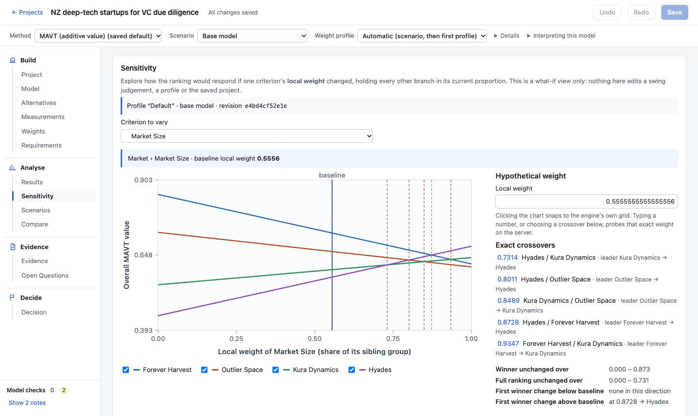
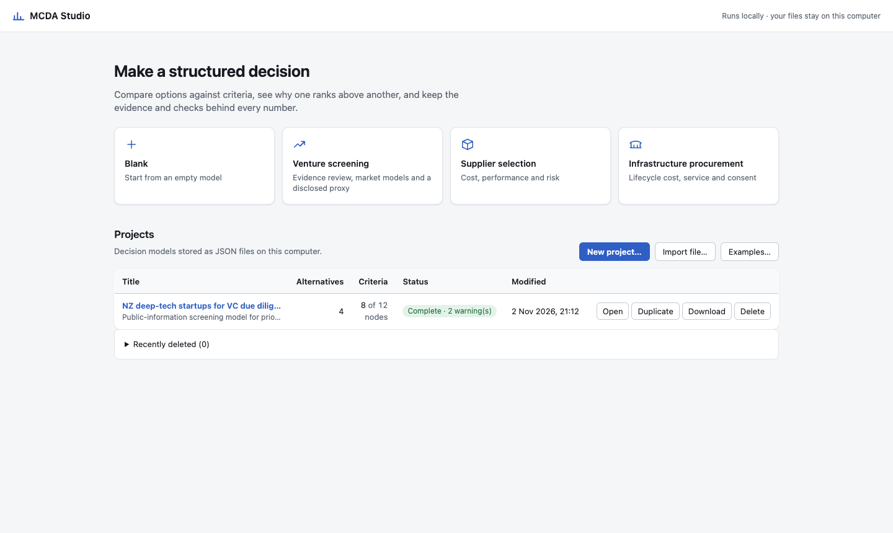
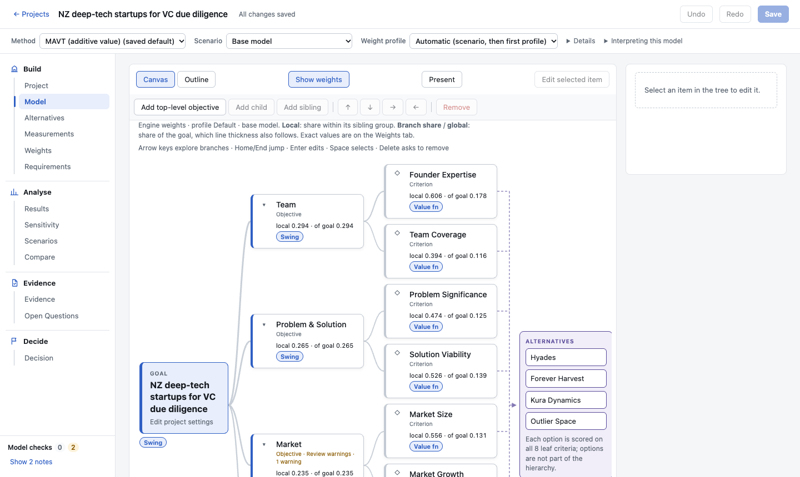
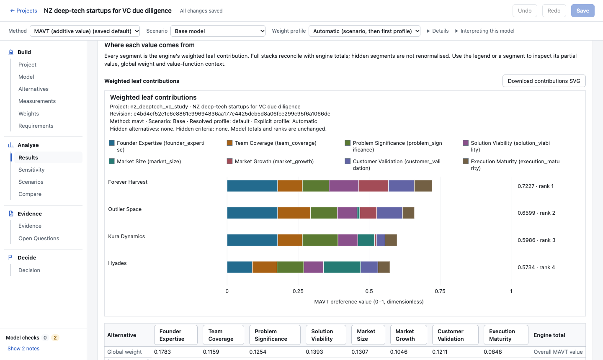

# MCDA Studio

**A local, transparent workspace for structured decisions.** MCDA Studio compares options against
criteria, shows why one option ranks above another, and keeps the evidence and checks behind every
number. It runs entirely on your own machine: one tested Python engine and CLI, a thin local
FastAPI service and a React/TypeScript interface.

Start from the gallery: **Blank**, **Supplier selection**, **Infrastructure procurement** or
**Venture screening**. Venture screening is the most developed domain. It brings together reviewed
classifier and model proposals, market-size models with uncertainty whose disagreements stay open
as questions, an off-by-default disclosed model proxy with a separate with/without analysis, and an
offline benchmark that checks a classifier's agreement with human reviewers.

The engine is domain-neutral: every domain is data and workflow, not engine logic. MCDA Studio never
predicts outcomes and never averages disagreements between methods, models or evidence; it shows
each reading and its reasons side by side. The model, criteria and preferences belong to the
decision maker.

The methods are **additive multi-attribute value theory (MAVT)** with hierarchical swing
weighting, **value-based sorting** of MAVT values into ordered classes, **SMAA-2**
acceptabilities under stated uncertainty, **PROMETHEE II** outranking flows as a
non-compensatory cross-check, and **AHP** priorities from pairwise judgements, with a view that
shows every method's own reading side by side, and a **feasibility check** of mandatory
requirements kept outside every score.



## A quick look

| | |
| --- | --- |
|  |  |
| **Start page.** Begin from a blank model or one of three starters. | **Model.** The value tree from goal to criteria, with engine weights on every branch. |
|  |  |
| **Results.** Each option's value, split into the contribution of every criterion. | **Sensitivity.** The exact weight at which the ranking changes, and who swaps. |

The screens show the `nz_deeptech_vc` example; see the disclaimer under [Examples](#examples).

## Features

**Evidence**

- The Evidence Workspace supports local claim inspection, explicit review, acknowledged compilation
  into a separate project copy, history-preserving exports and reproducible compilation bundles for
  the synthetic [venture and supplier demonstrations](examples/evidence_demo/README.md). Imported
  copies are related to their bundles through copy receipts. The Decision tab records, exports,
  reopens and revises version-2 decision records that cite those bundles and trace each
  measurement to them.
- External proposals add generic local JSON/CSV intake, model-card/source disclosure, exact
  tool/human comparisons, explicit individual or filtered bulk review, and history-preserving
  compilation into a separate copy. Confidence stays metadata and annotations stay outside
  numerical aggregation. See the invented [screening and supplier examples](examples/external_proposals/README.md)
  and [published interchange contract](docs/schemas/external-proposals-csv.md).
- A standalone offline [classifier agreement benchmark](examples/classifier_benchmark/README.md):
  human–human agreement gate with exact kappa and a grouped bootstrap interval, then exact
  confusion, abstention, baseline and calibration summaries against the reviewed reference. It is
  outside the application, calls no model and uses only local files.

**Modelling**

- A manifest-driven Blank, Supplier selection, Infrastructure procurement and Venture screening
  gallery. Fresh illustrative projects clear reviews and runs; intact worked examples retain
  them. Exported lineage receipts record the exact creation/reset and all local file hashes.
  See the [invented formula models](examples/market_research/README.md).
- Arbitrary-depth objective trees with stable IDs, so renaming never corrupts data.
- Categorical, ordinal, interval and ratio scales.
- Linear, piecewise-linear, qualitative and direct-rating value functions, with fixed or local
  anchors and an explicit out-of-domain policy.
- A graphical and tabular value-function editor. Changes are previewed, applied in one undoable
  step, and never applied by accident.

**Preferences**

- Hierarchical swing weighting over stated worst-to-best ranges. You see raw ratings, local
  weights, branch shares and global weights side by side.
- Multiple independent preference profiles, for example one per decision maker.
- Range-review warnings when a change alters what a weight means. Ratings are never silently
  adjusted.

**Analysis**

- Optional disclosed model proxy: explicitly reviewed model card, feature overlap and swing ratings,
  with a separate with/without comparison for MAVT, sorting or fixed-weight factor SMAA-2. The
  original project remains the baseline; imported confidence never becomes a weight.

- One-way weight sensitivity with exact, closed-form crossovers, stability intervals and an exact
  probe at any weight.
- Scenarios that override individual value functions and/or use another profile, compared with
  Base.
- Linked results: overall values, weighted contributions, partial-value heatmap and a dominance
  matrix.
- Tie-aware competition ranking (1, 1, 3) everywhere.
- Value-based sorting into ordered classes (for example Qualified / Conditional / Not qualified)
  by fixed boundaries on the overall value: each option's class and distance to the nearest
  boundary, the exact weight at which it first changes class, class bands on the charts, and an
  optional seed-keyed audit sample below a cut-off. Choosing a method is a view, like choosing a
  profile; nothing is edited until you make it the saved default.
- SMAA-2: state ranges or discrete outcomes for measurements and uncertainty for weights, then see
  how often each option takes each rank and class, with exact (Clopper–Pearson) intervals, a
  recorded seed and the label "sampled acceptability under these assumptions". Small discrete
  cases are computed exactly.
- PROMETHEE II: state each criterion's direction, weight and preference function (usual, U-shape,
  V-shape or linear, with thresholds in its units) and codes for labelled scales, then see net
  outranking flows on their own −1 to 1 axis, the PROMETHEE I partial order with its incomparable
  pairs, and an explanation of every pair it orders differently from MAVT: which criteria and
  thresholds are behind it, and how much of the gap comes from the other alternatives. Its inputs
  are its own, never the swing weights or value functions.
- AHP: judge criteria in pairs within each group, and the alternatives in pairs on each leaf, on
  Saaty's 1–9 scale; see each matrix's priorities, consistency ratio and most inconsistent triad
  live as you judge, then the overall priorities in distributive or ideal synthesis. Its judgements
  are its own and never become MAVT weights.
- Compare methods: every method's own reading of the same model side by side, each column naming
  what it read, where the methods agree on what comes first, and each method's own reason where
  they differ. A method that cannot read the model says why. There is no consensus score.
- Feasibility check: state mandatory requirements on individual measurements (a numeric bound in
  the criterion's own unit, or a set of allowed labels, with "at least" and "at most" helpers for
  ordinal scales) and see each alternative pass, fail or be unknown, live as you edit. A missing
  measurement is unknown, never a failure. No method reads requirements and no score offsets a
  failure: every ranking stays complete, with feasibility beside it in Results and the comparison.
- Retry after a failed analysis request. Retrying re-sends the same request and never edits the
  project.
- Open Questions: missing inputs, unresolved requirements, sensitivity, method disagreement and
  evidence-review gaps in separate groups. Accepted numeric evidence ranges can reveal a change
  in rank or class with fixed anchors; inspect analytical boundary contacts and evaluated examples.
  This is a one-measurement check, not global robustness or a probability estimate.
- Separate formula-model comparison with labelled source/support/exact/sampled ranges, persistent
  disagreement questions even on overlap, exact scope checks and one explicitly reviewed output
  per cell. Reviewed quantity checks cover deterministic inputs, supports and every draw.
- Calculated measurements: preview a local formula model in Measurements, inspect accepted source
  factors, dimensions and dependencies, explicitly review target changes and export a compiled
  static project copy with a reproducible calculation bundle. See the [two synthetic demonstrations](examples/derived_measurements/README.md).
  Formulas remain in separate local files. Fundamental-factor uncertainty uses separately reviewed
  runs; projects retain static compiled measurements.

**Reproducibility**

- Full-precision JSON exports that regenerate exactly. Formula-safe CSV and labelled SVG charts.
- Versioned JSON project files with conflict-aware saving.
- No calculation happens in the browser. The interface only displays engine results, checked
  against their context.

## Quick start

For a bundled wheel you need Python and pipx, but **no Node or source checkout**. The bundled
wheel is checked locally on macOS arm64 / Python 3.12 and on hosted Ubuntu 24.04 x86_64 / Python 3.12 CI.
Use a locally built or supplied release wheel (this repository does not publish to PyPI):

```sh
pipx install '/absolute/path/to/mcda_studio-0.1.0-py3-none-any.whl[api]'
mcda --version
mcda serve --open
```

Keep `[api]`: a plain wheel installs the engine/CLI dependencies, not the web-server dependencies.
The wheel includes the GUI and four examples. The default project library is
`~/.mcda-studio/projects`; `--store /path/to/library` chooses another directory.

**Developer setup** (Python 3.12 and Node 20.19+; locally tested Node 26.12.1):

```sh
git clone https://github.com/spar473/mcda-studio.git
cd mcda-studio
python3.12 -m venv .venv
.venv/bin/python -m pip install --require-hashes -r requirements/build-py312.txt -r requirements/dev-py312.txt
.venv/bin/python -m pip install --no-deps --no-build-isolation -e '.[dev]'
npm --prefix frontend ci
npm --prefix frontend run build
.venv/bin/mcda serve --open
```

The app opens at <http://127.0.0.1:8765>. In **Projects**, import the `supplier_selection` example to
explore a complete model, or create a blank project. The [user guide](docs/user-guide.md) walks
through every screen.

**Server options:**

- **Project library.** By default it is `~/.mcda-studio/projects`. Change it with
  `mcda serve --store /path/to/library` or the `MCDA_STUDIO_PROJECTS` environment variable.
- **Port.** `--port` changes it.
- **Runtime only.** The bundled `wheel[api]` route above needs no development tools.
- **One server per library.** The server binds to loopback only and has no authentication. Do not
  expose it on a network. The server owns its library for its lifetime; a second server fails clearly. Stop it before direct CLI writes into that library.

**Frontend development:** run `.venv/bin/mcda serve --no-open` and `npm --prefix frontend run dev`.
Vite serves on port 5173 and proxies `/api` to the backend; `MCDA_BACKEND` overrides the target.

**Deleted projects:** expand **Recently deleted** in Projects. Restore uses the original ID;
if it is active, Restore as copy assigns a new ID. Recovery entries are retained after success.

**Backups:** with the server stopped, `mcda library backup --store DIR --to FILE.zip` archives the
whole library, including Recently deleted; `mcda library verify FILE.zip` checks an archive and
`mcda library restore FILE.zip --to NEW_DIR` restores it into a new folder. See
[backup and restore](docs/design/library-backup-and-restore.md) and
[recovery and coordination limits](docs/development/library-recovery.md).

## Command line

The `mcda` CLI works directly on project files:

```sh
mcda validate examples/supplier_selection/project.json          # completeness report
mcda evaluate examples/supplier_selection/project.json          # ranking, weights and contributions
mcda sensitivity examples/supplier_selection/project.json --all # one-way sensitivity for every node
mcda compare examples/supplier_selection/project.json           # scenarios against Base
mcda evaluate examples/supplier_qualification/project.json      # classes by value-based sorting
mcda uncertainty cell supplier.json apex unit_price --uniform 38 46   # state a range
mcda evaluate supplier.json --method smaa2 --seed 7             # sampled acceptability
mcda promethee criterion supplier.json unit_price --minimise --weight 3 --linear 2 10
mcda evaluate supplier.json --method promethee2                 # net outranking flows
mcda ahp judge supplier.json --top cost performance 3           # one pairwise judgement
mcda evaluate supplier.json --method ahp                        # AHP priorities
mcda compare-methods supplier.json                              # every method side by side
mcda requirement bound supplier.json price_cap unit_price --name "Within budget" --max 45 --unit NZD
mcda feasibility supplier.json                                  # pass, fail or unknown per requirement
mcda new "Choose a supplier" -o my-decision.json --template supplier-selection
```

A template gives you a structure to fill in. Other commands edit models: `alternative`,
`criterion`, `measure`, `weight` and `duplicate`. Run `mcda --help` or `mcda <command> --help` for
details.

## Examples

| Example | What it shows |
| --- | --- |
| [`supplier_selection`](examples/supplier_selection/) | A compact five-alternative problem with an independent oracle |
| [`supplier_qualification`](examples/supplier_qualification/) | The same suppliers sorted into Qualified, Conditional and Not qualified by value-based sorting, with an empty class under one profile, a class change under a scenario and an audit sample |
| [`infrastructure_procurement`](examples/infrastructure_procurement/) | A three-level tree with mixed scales, an only child, a zero rating, two disagreeing profiles and a profile-aware scenario |
| [`nz_deeptech_vc`](examples/nz_deeptech_vc/) | A complete study prioritising four NZ deep-tech startups for venture-capital due diligence, with a piecewise market-size function, a linear scenario and documented sensitivity thresholds. It is the main regression fixture. See the disclaimer below the table |

**About the `nz_deeptech_vc` example.** It names four real companies, from public information. The
scores are illustrative judgements made in September 2026. Nothing in it is investment advice or a
statement about the companies, and there is no affiliation with or endorsement by them.

## How to read the results

- **Scores are preferences.** They lie in [0, 1] and are not probabilities, forecasts or financial
  returns.
- **Additive MAVT compensates.** It assumes preferential independence and lets strong criteria
  offset weak ones, so screen hard requirements separately.
- **Local anchors depend on the alternatives.** Changing the alternatives can change scores and
  what weights mean.
- **One-way sensitivity is not proof of robustness.**

See [method limitations](docs/mathematics/method-limitations.md).

## Documentation

| Topic | Where |
| --- | --- |
| Using the app | [User guide](docs/user-guide.md) |
| Mathematics | [Specification](docs/mathematics/specification.md) · [Limitations](docs/mathematics/method-limitations.md) |
| Architecture and file format | [Overview](docs/architecture/overview.md) · [Project schema](docs/architecture/project-schema.md) |
| HTTP API | [API contract](docs/api/contract.md) · [OpenAPI](docs/api/openapi.json) |
| Design notes per feature | [docs/design/](docs/design/) |
| Development, testing and validation | [Testing](docs/development/testing.md) · [Validation](docs/development/validation.md) |
| Direction and plans | [Roadmap](ROADMAP.md) · [Known limitations](docs/development/known-limitations.md) |
| Release history | [CHANGELOG](CHANGELOG.md) |

The full index is in [docs/README.md](docs/README.md).

## Quality

Every change runs through:

- **Python checks:** pytest (unit, API, property and regression tests), Ruff and strict mypy.
- **Contract checks:** OpenAPI and TypeScript freshness.
- **Frontend checks:** Vitest, ESLint and a production build.
- **Browser tests:** Playwright against the real backend.
- **A mutation harness** that injects realistic defects, all of which must be caught.

The final local gate (2 November 2026) passed 1,957 Python, 451 frontend and 113 browser tests,
caught all 344 mutations (264 backend, 80 frontend) with the unmodified copy passing, and kept all
969 earlier numerical/export outputs byte-identical; see the
[classifier agreement benchmark record](docs/development/classifier-agreement-benchmark-verification.md)
and the dated records of each earlier development.

The [integrated sprint gate](docs/development/integrated-workspace-verification.md) on 1 November
2026 passed 1,594 Python, 398 frontend and 96 browser tests, static/schema/build checks, and
969 numerical/export byte-identity comparisons. The mutation audit covers 151 backend and 60
frontend defects, with one equivalent checksum case explicitly replaced and documented.

The historical local gate (28 October 2026, after the method seam's backend contract) passed 731
Python, 313 frontend and 81 browser tests, with 94 of 94 mutants caught; see the
[method seam check record](docs/development/method-seam-verification.md) and the earlier
[library backup](docs/development/library-backup-verification.md),
[measurement coverage](docs/development/measurement-coverage-verification.md) and
[analysis retry](docs/development/analysis-retry-verification.md) check records. The original baseline
(616, 234 and 67 tests, 64 of 64 mutants) is kept in [validation](docs/development/validation.md).
Installation and startup checks are recorded in [installation verification](docs/development/package-b-verification.md).
Library ownership and recovery are described in [library recovery](docs/development/library-recovery.md), with their own check record.
The visible model adds a live Model canvas: a left-to-right value tree (goal → objectives → criteria, with the
options beside it), engine weights, shortcuts to the existing editors and a read-only presentation
view, plus a compact Outline; see [visible-model verification](docs/development/package-d1-verification.md).
The Model canvas also includes paged measurement coverage linked to the existing inputs, with
missing inputs and engine issues shown separately.
All four examples are checked against oracles written independently of the engine; the
supplier qualification oracle also recomputes classes, distances, the audit sample and every
class-change weight, an SMAA-2 oracle enumerates discrete cases exactly, and a PROMETHEE II oracle
reproduces two published examples in exact fractions; an AHP oracle in exact fractions and LAPACK
check its priorities against a published matrix. See
[testing](docs/development/testing.md) and [validation](docs/development/validation.md).

## Scope and status

Implemented and covered by automated checks: additive MAVT with swing weighting, end to end, and
value-based sorting of its values into ordered classes, SMAA-2 acceptabilities, and PROMETHEE II
net flows with an explanation against MAVT, AHP priorities with consistency checks, the
method comparison view, and the feasibility check of mandatory requirements. No
fresh-user usability checkpoint has passed yet.

The direction is a complete decision workflow: frame the decision, define requirements, model
alternatives and preferences, review evidence, analyse trade-offs, record a choice and revisit
assumptions. The modelling and analysis stages exist today. The [roadmap](ROADMAP.md) shows each
stage's status and the committed next packages.

Not yet implemented:

- a decision-record browser, signed records or library storage (records are exported files);
- live formula editing and uncertainty propagation through calculated measurements;
- other MCDA methods (for example SMART/SMARTER), started only when user needs call for them;
- uncertainty analysis beyond SMAA-2's stated, independent distributions (correlated sampling,
  robustness over every admissible weight);
- durable draft recovery and scheduled backups;
- multi-user or cloud use.

Bundled distribution, library ownership, Recently deleted restoration, library backup archives and Linux CI configuration are implemented; see
[build/install checks](docs/development/testing.md#distribution-build-and-clean-install) and the
[roadmap](ROADMAP.md).

## Background and acknowledgements

MCDA Studio grew out of the author's study *Prioritising New Zealand Deep-Tech Startups for Venture
Capital Due Diligence* (September 2026), which was carried out in DECERNS. The report is not
distributed with the project; [docs/reference/original-study/](docs/reference/original-study/) holds
its citation and a summary. The tool itself is generic: the study is data, not engine logic.

MCDA Studio is an independent project. It is **not affiliated with, endorsed by or derived from
DECERNS** or its developers. It contains no DECERNS source code, assets or file formats, and does
not claim compatibility with DECERNS. "DECERNS" is used only to describe the workflow that inspired
it.

[ACKNOWLEDGEMENTS.md](ACKNOWLEDGEMENTS.md) credits DECERNS, REA, data sources, open-source
dependencies and AI assistance, and sets out what the licence covers.

## Licence

The code and documentation are released under the [MIT licence](LICENSE). Third-party names and
software keep their own terms; see [ACKNOWLEDGEMENTS.md](ACKNOWLEDGEMENTS.md).
