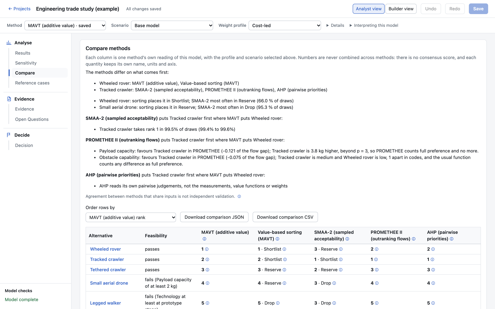
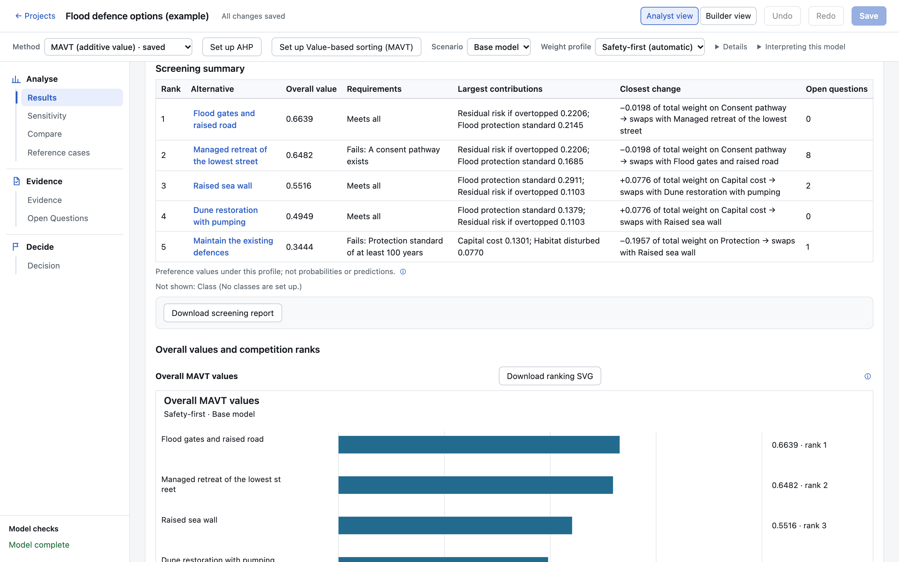
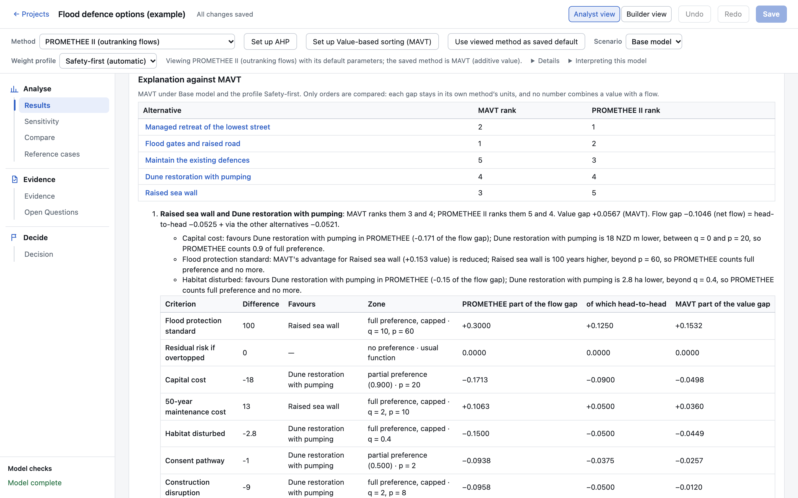
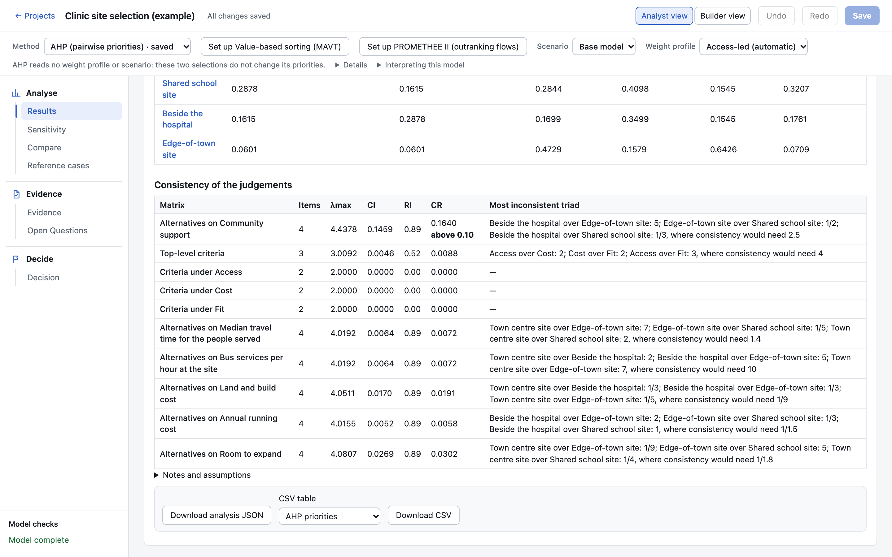
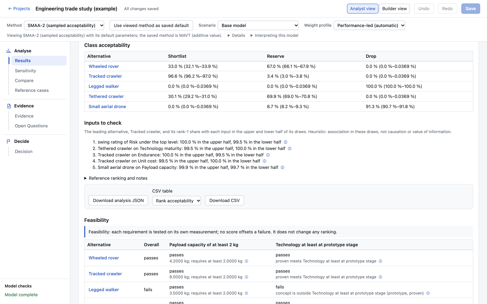
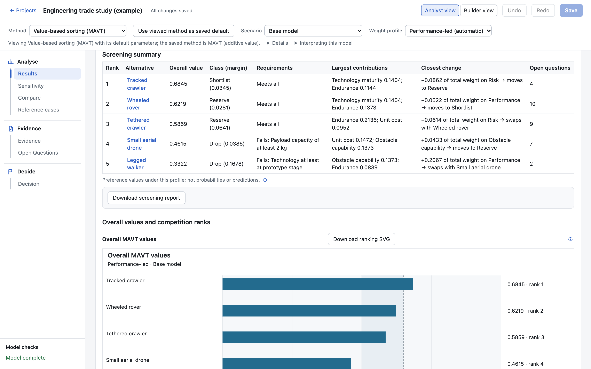

# A six-minute tour of the methods

Six stops in the application, one method each, on the three invented worked examples. Every name and
figure here is invented. Every number below is computed by the engine and stated in the example's own
README, which says where it comes from; the headline facts of each study are pinned by tests in the
source distribution. The tour only tells you where to look, and nothing in it is a recommendation.

**Before you start:** run the application (see [quick start](../README.md#quick-start)) and open the
start page. Start each example from its card, or from **Projects → Examples**. The worked examples open
in the **Analyst view**, which shows the left navigation (Analyse, Evidence, Decide) and no model
editors; **Builder view**, at the top right, adds them. Looking never changes a project: choosing a
method, a weight profile or a scenario is a view, and nothing is saved until you make it the default.

## 1. Compare: five methods, no consensus (about a minute)

Start **Engineering trade study**, choose the weight profile **Cost-led**, then open **Compare** in the
left navigation. Five inspection-vehicle concepts are read by MAVT, value-based sorting, SMAA-2,
PROMETHEE II and AHP, in five columns.

- Under **Performance-led** all five methods put the *Tracked crawler* first.
- Under **Cost-led**, MAVT and sorting lead with the *Wheeled rover*. SMAA-2, PROMETHEE II and AHP
  still lead with the *Tracked crawler*, because PROMETHEE II and AHP read no weight profile and
  SMAA-2's top-level weights come from its own stated intervals.
- Where the methods differ, each column gives its own reason. There is no combined score and no
  ranking of the methods.

Agreement between methods that read the same measurements is not independent validation, and
disagreement is not an error to reconcile.

## 2. A requirement beside the ranking (about a minute)

Start **Flood defence options**. Its Results page opens on the screening summary: a ranking with each
option's **requirement status** beside it.

- *Maintain the existing defences* is the cheapest option and fails the protection requirement (25
  years against at least 100).
- *Managed retreat of the lowest street* fails the consent requirement, and still leads PROMETHEE II.
- A failing option stays in the ranking. The status changes no value; a test removes the requirements
  and finds every MAVT value and PROMETHEE II flow unchanged. That is why a hard limit is a
  requirement and not a low weight.
- Click an option's name for its **alternative detail**: its requirements, every scored contribution
  and the closest change. It is read-only.

## 3. PROMETHEE II against MAVT (about a minute)

In the same study, change **Method** to **PROMETHEE II (outranking flows)** and scroll to
**Explanation against MAVT**. Under the **Safety-first** profile the two methods order four pairs
differently, and the table gives both ranks.

- Take the pair *Raised sea wall* and *Dune restoration with pumping*. MAVT ranks them 3 and 4;
  PROMETHEE II ranks them 5 and 4.
- The explanation lists, per criterion, the difference, who it favours, which part of the preference
  function applies, and how much of the flow gap comes from that criterion. The capital-cost row, for
  example, says *Dune restoration with pumping* costs 18 NZD m less, between the thresholds q = 0 and
  p = 20, so PROMETHEE II counts 0.9 of full preference.
- The flow gap is split into the head-to-head part and the part that goes *via the other
  alternatives*. The preference function caps a large advantage at full preference, which is how a
  method that still adds across criteria can order a pair differently from MAVT.

PROMETHEE II reads its own weights and thresholds, never the swing weights or value functions.

## 4. AHP and its consistency (about a minute)

Start **Clinic site selection**. Its saved method is AHP, so Results opens on the priorities and the
**Consistency of the judgements**.

- 42 pairwise answers, all the author's own, on Saaty's 1 to 9 scale. AHP reads none of the
  measurements or swing weights.
- One matrix is flagged: *Community support* has a consistency ratio of about 0.16, above the 0.10
  threshold. It is listed first, its most inconsistent triad is named, and Results shows the
  `AHP_INCONSISTENT` warning. Every other matrix is at or below about 0.03.
- The engine changes nothing because of the flag. A low ratio does not show judgements are right, and
  a high one does not show they are wrong; it is a hint to revisit them.

## 5. SMAA-2: shares of draws, not probabilities (about a minute)

Back in **Engineering trade study**, choose the **Performance-led** profile and the method **SMAA-2**,
and read the SMAA-2 results; **Class acceptability** is the panel pictured below. The study states
ranges for endurance, payload and unit cost, one unsettled maturity and uncertain top-level swing
ratings; the default combined run uses 10,000 draws with seed 0, and its shares depend on the profile.

- The *Tracked crawler* is first in 99.8% of draws.
- The *Wheeled rover* is *Shortlist* in 33.0% of draws and *Reserve* in 67.0%.
- Each share comes with an exact interval and the recorded seed, under the label "sampled acceptability
  under these assumptions". A share of draws is not a probability of anything.

## 6. Sorting: how close is a class boundary? (about a minute)

In the same study, change **Method** to **Value-based sorting (MAVT)**. Three ordered classes, *Shortlist*,
*Reserve* and *Drop*, are fixed boundaries on the overall value (0.65 and 0.50), and each concept shows
its class and its distance to the nearest boundary.

- Under **Performance-led** the *Wheeled rover* is *Reserve*, 0.028 below the *Shortlist* boundary.
  Under the scenario *Diminishing returns on endurance* it rises to 0.6591 and becomes *Shortlist*.
- The boundaries are the author's judgements, chosen here so that one concept sits close to one. A
  concept near a boundary moves class under small changes.

## What to take away

- One model, several methods, each reading **only its own inputs**; no method's weights are reused by
  another.
- A requirement is never offset by a score.
- Every number comes from the Python engine and is checked against an independent oracle; the
  interface draws and joins results by ID and computes nothing.
- These are invented studies with one author's judgements. They show how the methods read a model, not
  how to choose an inspection vehicle, a clinic site or a flood defence.

The exact rules are in the [specification](mathematics/specification.md), the per-method
[design notes](design/) and [method limitations](mathematics/method-limitations.md). Each example's
[README](../examples/README.md) explains where its figures come from and rebuilds it from a script.
